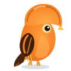
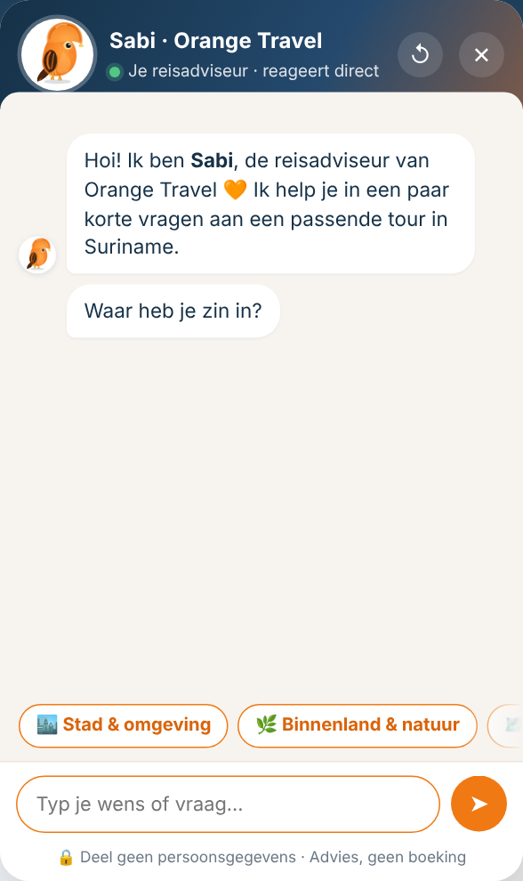
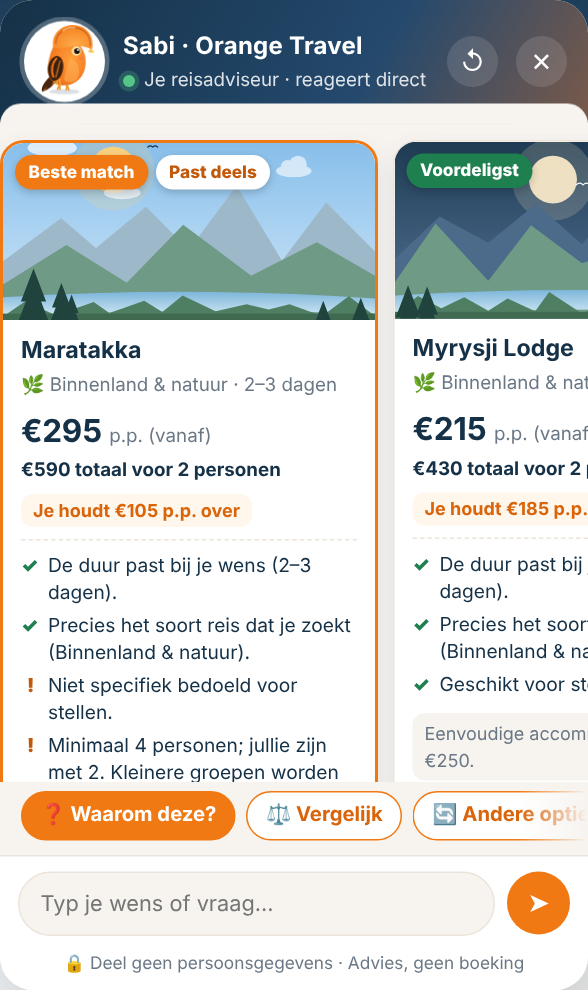
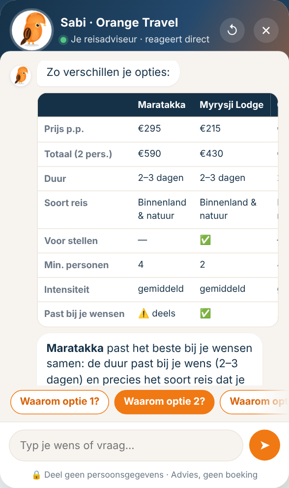
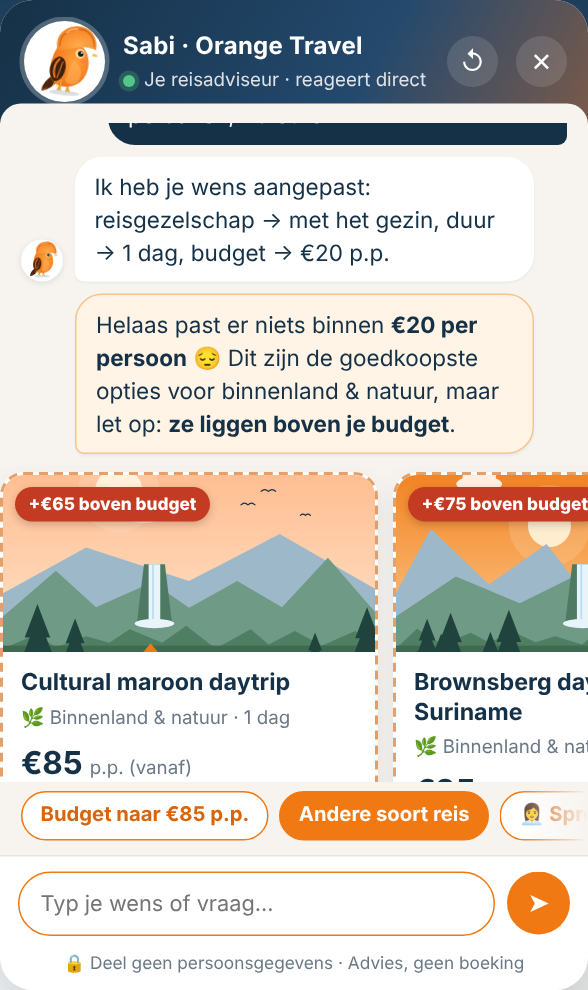
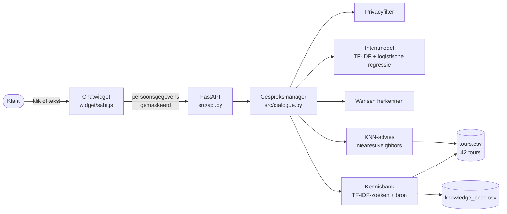
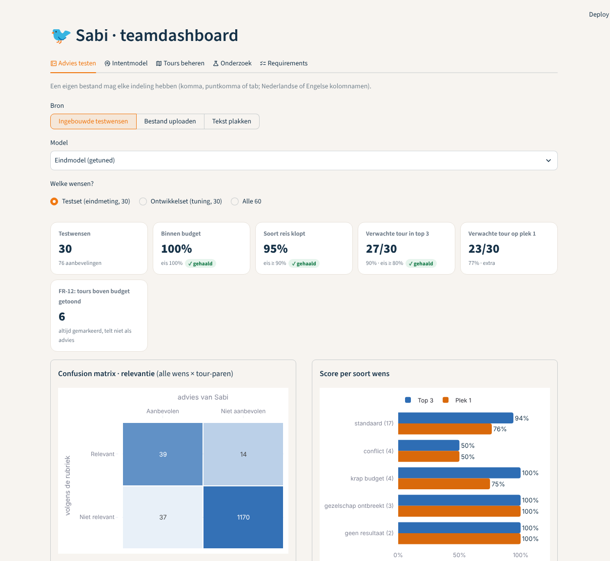
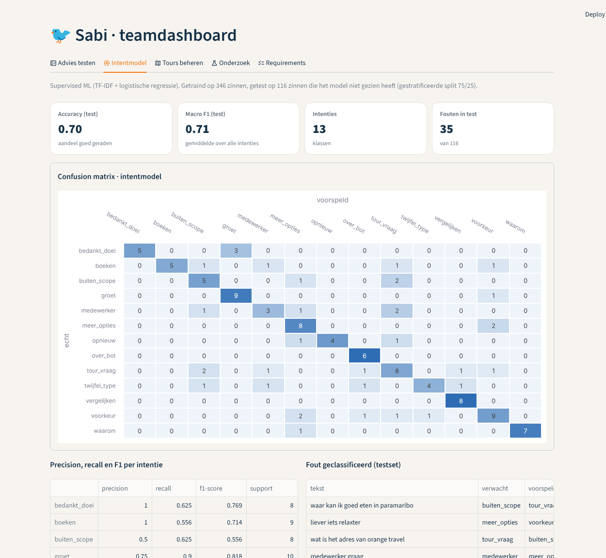

<p align="center">
  
</p>

<h1 align="center">Sabi · AI-reisadviseur voor Orange Travel</h1>

<p align="center">
  <a href="https://github.com/Nikhcodes/orange-travel/actions/workflows/tests.yml"></a>
  
  
  
</p>

<p align="center"><b>Een chatbot die klanten van Orange Travel Suriname in een paar vragen naar een passende tour helpt,<br>
met een eerlijke uitleg, binnen het budget, en altijd met een link naar de bron.</b></p>

<p align="center">
  
  
  
  
</p>

---

## Wat is Sabi?

**Sabi** is een rotshaan uit het Surinaamse regenwoud en de reisadviseur van Orange Travel. *Sabi* betekent "weten" in het Sranantongo, en zo willen we hem ook: een slimme, behulpzame adviseur.

Sabi zit als **chatknop rechtsonder op de website** (FR-21). Hij doet het volgende:

- Hij vraagt stap voor stap naar **budget, reisduur, soort reis en reisgezelschap**. De klant kan op knoppen klikken of gewoon typen.
- Hij raadt **maximaal 3 tours van Orange Travel in Suriname** aan, met prijs, totaalprijs voor de groep en een uitleg ✓ / !.
- Hij legt uit **waarom**, **vergelijkt** opties en zoekt **goedkopere, langere of rustigere** alternatieven.
- Hij beantwoordt **vragen** met informatie van orangesuriname.com, **altijd met bronlink**.
- Hij **boekt niets**: daarvoor verwijst hij naar de tourpagina of een reisadviseur.
- Hij **waarschuwt bij persoonsgegevens** en verwijdert die al in de browser.

> Studieproject van UNASAT. Dit is **niet** de officiële chatbot van Orange Travel. Tourgegevens komen van [orangesuriname.com](https://www.orangesuriname.com/en/) (gecontroleerd op 27-11-2026); de website is altijd leidend.

## Snel starten

Vereist: [uv](https://docs.astral.sh/uv/) (Fedora: `sudo dnf install uv`) en Python 3.11 of nieuwer.

```bash
git clone https://github.com/Nikhcodes/orange-travel.git
cd orange-travel
uv sync                                    # installeert exact de versies uit uv.lock

uv run uvicorn src.api:app --reload        # chatbot  ->  http://localhost:8000/demo
uv run streamlit run dashboard.py          # teamdashboard -> http://localhost:8501  (2e terminal)
uv run pytest                              # alle tests (± 1 minuut)
```

**Sabi op de échte website laten zien:** open <http://localhost:8000/demo/bladwijzer>, sleep de oranje knop naar je bladwijzerbalk, open orangesuriname.com en klik op de bladwijzer. Sabi verschijnt dan alleen in jouw browser.

**Inbouwen op een website** kost één regel:

```html
<script src="https://JOUW-SERVER/widget/sabi.js" defer></script>
```

## Hoe werkt het?



Er zitten **twee machine learning-modellen** in, beide met scikit-learn:

| Model | Soort | Wat het doet |
|---|---|---|
| **K-Nearest Neighbors** (`NearestNeighbors`) | Unsupervised | Zoekt de tours die het meest lijken op de wens: budget, duur (log, geschaald), soort reis (one-hot) en gezelschap. Gewichten zijn getuned op een aparte ontwikkelset. |
| **Intentclassifier** (TF-IDF + `LogisticRegression`) | Supervised | Herkent wat de klant wil: wens geven, vraag stellen, vergelijken, boeken, een mens spreken… (13 intenties, 462 zinnen) |

De budgetregel en de privacycontrole zijn bewust **harde regels** en geen ML: daar mag niets "ongeveer" gebeuren.

## Resultaten

Eindmeting op **30 testwensen** die niet zijn gebruikt om het model af te stellen:

| Succescriterium (opdracht) | Eis | Resultaat |
|---|---|---|
| Aanbevelingen binnen budget | 100% | **100%** ✅ |
| Soort reis klopt | ≥ 90% | **94,7%** ✅ |
| Vooraf bepaalde beste tour in top 3 | ≥ 24/30 | **27/30** ✅ |
| Extra: beste tour op plek 1 | – | 23/30 |
| Intentmodel (testset, 13 klassen) | – | accuracy 0,70 · macro-F1 0,71 |

Alle cijfers zijn opnieuw te berekenen in het dashboard (*Advies testen* en *Intentmodel*), inclusief confusion matrices.

<p align="center"> </p>

## Projectstructuur

```
orange-travel/
├── src/
│   ├── api.py                   # FastAPI: /api/chat, widget, demo
│   ├── dialogue.py              # gespreksmanager (alle FR's)
│   ├── recommendation_engine.py # KNN + budgetregel + uitleg
│   ├── preprocessing.py         # get_dummies, log, StandardScaler, gewichten
│   ├── rubric.py                # verwachte uitkomst testwensen (FR-07)
│   ├── evaluation.py            # succescriteria + confusion matrix
│   ├── experiments.py           # tuning + onderzoeksvragen
│   ├── knowledge.py             # vragen beantwoorden met bron
│   ├── texts.py                 # alle zinnen van Sabi
│   └── nlu/                     # intentmodel, wensen herkennen, privacy
├── widget/                      # sabi.js, sabi.css, sabi.svg (de rotshaan)
├── demo/                        # demopagina + bladwijzer-demo
├── dashboard.py                 # teamdashboard (Streamlit)
├── data/                        # tours, testwensen, intenties, kennisbank
├── scripts/                     # data valideren, testwensen bouwen, tunen
├── tests/                       # 63 tests, per requirement
└── docs/                        # handleidingen en documentatie
```

## Documentatie

| Document | Voor wie |
|---|---|
| [Klanthandleiding](docs/klanthandleiding.md) | Klanten en medewerkers van Orange Travel |
| [Ontwikkelaarshandleiding](docs/ontwikkelaarshandleiding.md) | Het team: installeren, testen, data bijwerken, Git-workflow |
| [Technische documentatie](docs/technische_documentatie.md) | Verslag en verdediging: hoe en waarom het werkt |
| [Requirements → code → test](docs/requirements.md) | Welke requirement waar gebouwd en getest is |
| [Presentatiegids](docs/presentatiegids.md) | Taakverdeling, demoscript en vragen van de docent |
| [Bijdragen](CONTRIBUTING.md) | Hoe we samenwerken op GitHub |

## Team

Dwayne Danoeatmodjo · Jo-melly Amatbahrowi · Karan Ramnarain · Nikhiel Lingard · Riecha Mohab-Ali

## Rechten

De code is geschreven voor een UNASAT-studieproject. Het logo, de naam en de tourinformatie van Orange Travel Suriname zijn eigendom van Orange Travel en worden met hun toestemming gebruikt. Sabi en de illustraties zijn eigen ontwerpen van het team.
