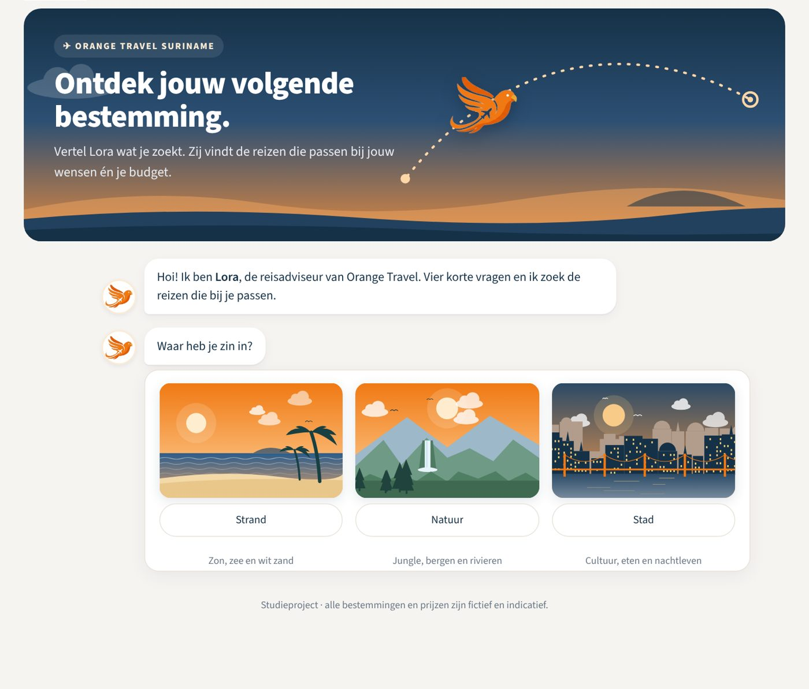
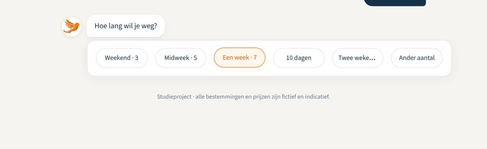
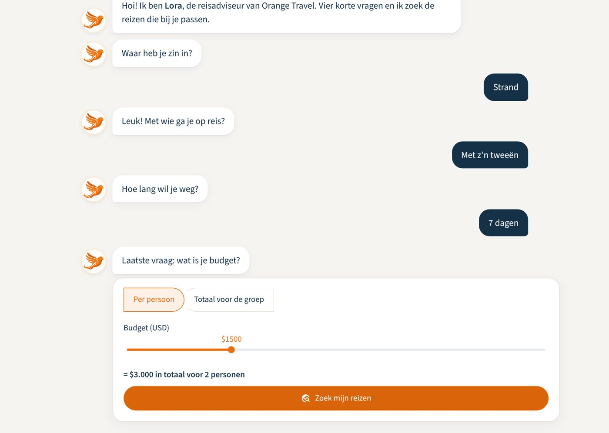
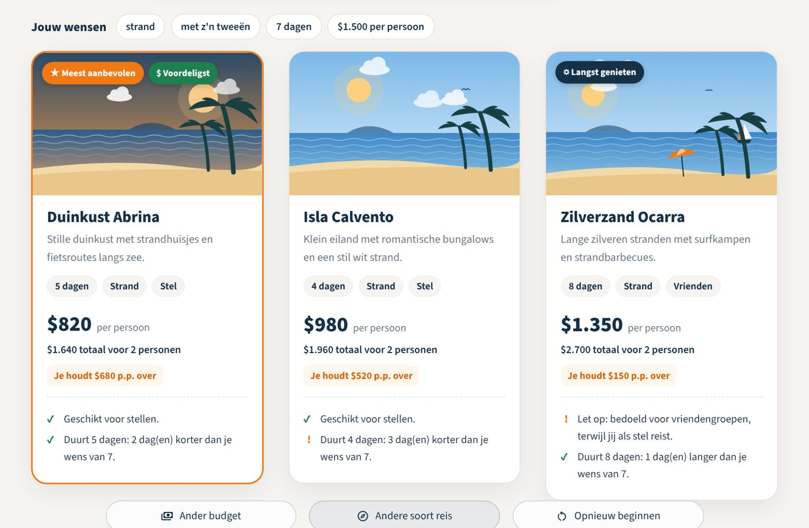
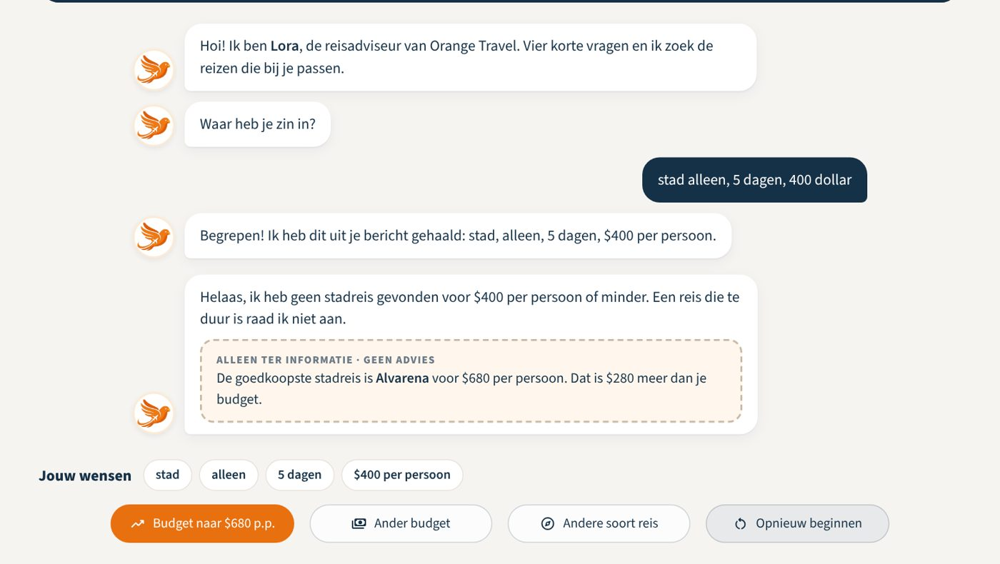

# Zo werkt de reisadviseur van Orange Travel

Weet je nog niet waar je heen wilt? **Lora**, onze oranje lovebird, helpt je in een paar klikken aan een passend reisadvies.

---

## 1. Open de reisadviseur

Lora begroet je en stelt haar eerste vraag. Rechtsboven kies je de taal: **Nederlands** of **Sranan**.

## 2. Beantwoord vier vragen

| Vraag | Wat je doet |
|---|---|
| **Waar heb je zin in?** | Klik op *Strand*, *Natuur* of *Stad*. |
| **Met wie ga je op reis?** | *Alleen*, *Met z'n tweeën*, *Met het gezin* of *Met vrienden*. Bij gezin of vrienden vul je daarna het aantal personen in. |
| **Hoe lang wil je weg?** | Kies bijvoorbeeld *Een week · 7*, of *Ander aantal*. |
| **Wat is je budget?** | Kies *Per persoon* of *Totaal voor de groep* en schuif naar je bedrag. Lora rekent het meteen voor je om. Klik daarna op **Zoek mijn reizen**. |

> **Liever typen?** Typ je wens onderaan in één zin, bijvoorbeeld:
> *strand met mijn vriendin, 7 dagen, 1500 dollar*.
> Lora haalt eruit wat ze begrijpt en vraagt alleen nog wat ontbreekt.

## 3. Bekijk je advies

Je krijgt **maximaal drie reizen** die binnen je budget passen.

| Label | Betekenis |
|---|---|
| ★ **Meest aanbevolen** | Past het best bij al je wensen samen. |
| $ **Voordeligst** | De laagste prijs van deze drie. |
| ☼ **Langst genieten** | De reis met de meeste dagen van deze drie. |

Op elke kaart zie je:
- de **prijs per persoon** en, als je met meer mensen reist, het **totaal voor de groep**;
- hoeveel budget je per persoon **overhoudt**;
- **waarom** Lora deze reis kiest. Een ✓ betekent dat het klopt met je wens. Een **!** betekent dat iets afwijkt, bijvoorbeeld een reis die bedoeld is voor vrienden terwijl jij als stel reist.

Met de knoppen onder de kaarten kies je **Ander budget**, **Andere soort reis** of **Opnieuw beginnen**.

## 4. Geen reis binnen je budget?

Dan zegt Lora dat eerlijk. Een reis die duurder is dan je budget raadt ze **nooit** aan. Ter informatie noemt ze wel de goedkoopste reis van die soort, zodat je weet hoeveel extra budget nodig is. Met één klik op **Budget naar …** zoek je opnieuw met dat bedrag.

## 5. Goed om te weten

- Alle prijzen zijn **indicatief** en gelden **per persoon**.
- Dit is een **advies**. Boeken, betalen, vluchten, visum en beschikbaarheid regel je met een medewerker van het reisbureau.
- Lora slaat geen persoonsgegevens op. Na het sluiten van de pagina is je gesprek weg.

---
*Studieproject UNASAT. De bestemmingen en prijzen in deze reisadviseur zijn verzonnen.*
