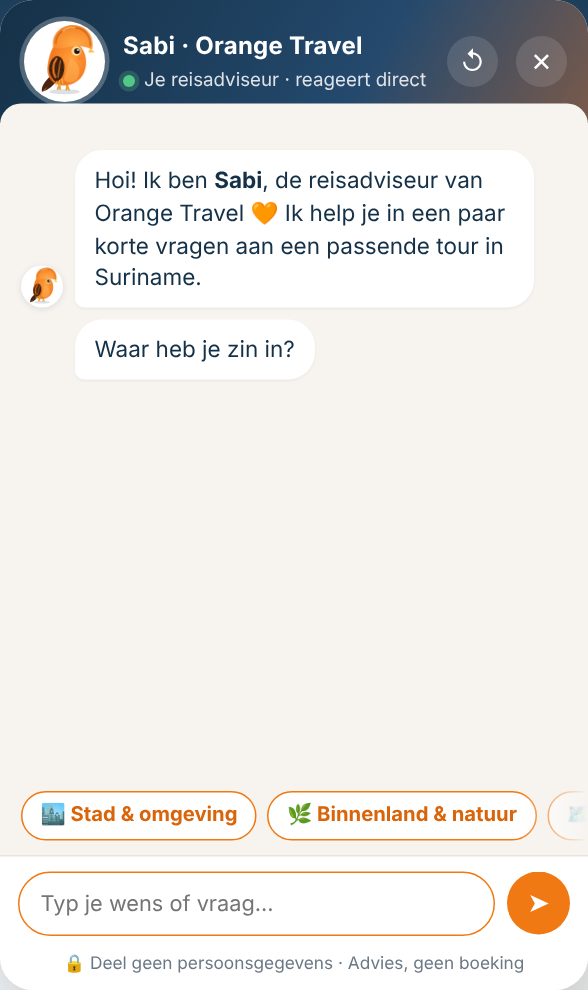
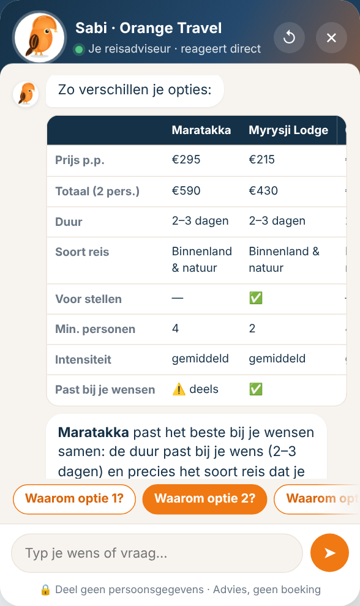
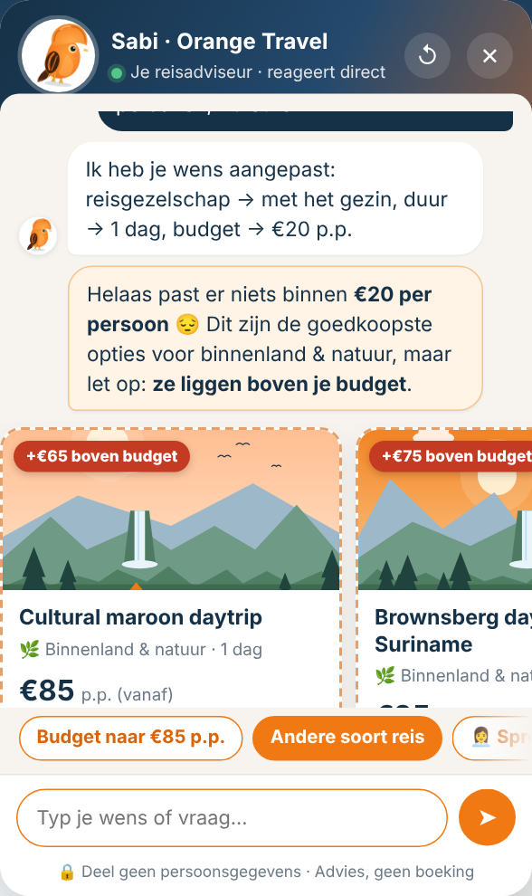

# Zo werkt Sabi, de reisadviseur van Orange Travel

Weet je nog niet welke tour je in Suriname wilt doen? **Sabi**, onze rotshaan, helpt je in een paar vragen aan een passend advies.

---

## 1. Open de chat
Klik rechtsonder op de website op de ronde knop met Sabi. Het chatvenster opent en Sabi stelt zijn eerste vraag.

## 2. Beantwoord vier korte vragen

| Sabi vraagt | Jij kiest |
|---|---|
| **Waar heb je zin in?** | 🏙️ *Stad & omgeving* · 🌿 *Binnenland & natuur* · 🗺️ *Rondreis* · of 🤔 *Ik twijfel*: dan legt Sabi het verschil uit |
| **Met wie ga je op reis?** | Alleen, met z'n tweeën, met het gezin of met vrienden (en daarna met hoeveel personen) |
| **Hoeveel tijd heb je?** | Van *een paar uur* tot *twee weken of langer* |
| **Wat is je budget per persoon?** | Kies een bedrag, of typ je eigen bedrag |

**Liever typen?** Typ alles in één keer, bijvoorbeeld:
*"binnenland, 3 dagen, met mijn vriendin, €400 per persoon"*.
Sabi haalt eruit wat hij begrijpt en vraagt alleen nog wat ontbreekt. Van gedachten veranderd? Typ gewoon *"toch liever 2 dagen"*.

## 3. Bekijk je advies
Je krijgt maximaal **drie tours** die binnen je budget passen.

Op elk kaartje staat:
- de **prijs per persoon** (vanafprijs) en het **totaal** voor je groep;
- hoeveel budget je **overhoudt**;
- **waarom** de tour past: ✓ betekent dat het klopt met je wens, **!** betekent dat iets afwijkt (bijvoorbeeld een minimum van 4 personen), en *i* is een tip;
- de knop **Bekijk tour** naar de tourpagina van Orange Travel.

| Label | Betekenis |
|---|---|
| **Beste match** | Past het best bij al je wensen samen |
| **Voordeligst** | De laagste prijs van de getoonde tours |
| **Past deels** | Niet alles klopt; kijk naar de **!** |

## 4. Vraag gerust door
Klik op een knop of typ je vraag:

| Je wilt… | Klik / typ |
|---|---|
| weten waarom | **Waarom deze?** |
| opties naast elkaar zien | **Vergelijk** |
| iets anders | **Andere opties**, *"iets goedkopers"*, *"iets rustigers"*, *"langer"* |
| informatie over een tour | *"Hoeveel kost Awarradam?"*, *"Is Brownsberg zwaar?"*, *"Hoe kan ik betalen?"* |
| een mens spreken | **Spreek een adviseur** |

Bij informatie staat altijd een link **Bron: orangesuriname.com**. De website is leidend.

## 5. Te laag budget?
Past er niets binnen je budget, dan zegt Sabi dat eerlijk. Hij laat de goedkoopste opties zien, duidelijk gemarkeerd als **boven je budget**. Met één klik op **Budget naar €…** zoek je opnieuw.

## 6. Goed om te weten
- **Sabi geeft advies en boekt niets.** Boeken doe je via de knop *Book now* op de tourpagina of via een reisadviseur: +597 421984 / +597 8773397 (ma–vr 8:00–19:00, za 12:00–19:00).
- **Deel geen persoonsgegevens** zoals je naam, e-mailadres of telefoonnummer. Sabi heeft ze niet nodig en verwijdert ze automatisch.
- Sabi bewaart je gesprek niet. Sluit je de pagina, dan is het weg.
- Prijzen zijn *vanafprijzen* per persoon en kunnen veranderen.
